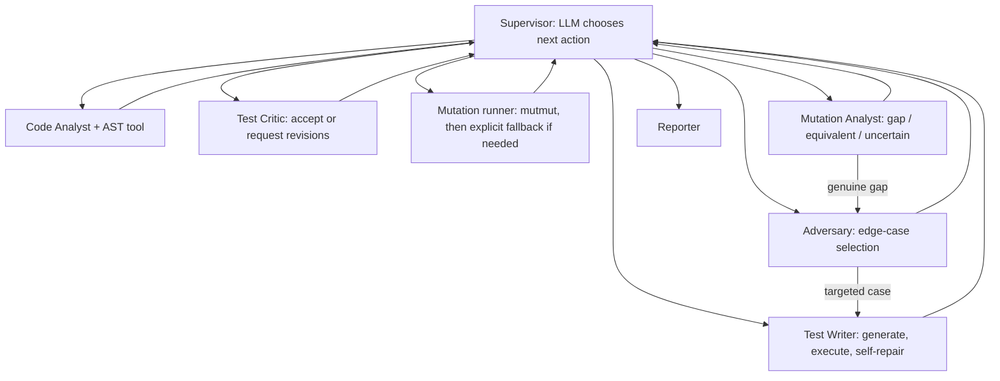

# Mutation-Guided Test Suite Generator

A multi-agent system that creates pytest tests for a Python function, executes them, runs mutation testing, classifies surviving mutants, and routes back for targeted revisions. The project uses LangGraph for stateful routing and the OpenAI Responses API for agent decisions.

## Quick start

```bash
python -m venv .venv
# Windows: .venv\Scripts\activate
# macOS/Linux: source .venv/bin/activate
pip install -r requirements.txt
cp .env.example .env   # Windows PowerShell: Copy-Item .env.example .env
# Add OPENAI_API_KEY to .env; keep .env out of Git.
```

## Run the web frontend

The project includes a web frontend where you can enter Python code or upload a `.py` file, generate tests, and review pytest, mutation-testing, and agent-report results without manually submitting API requests.

### 1. Start the backend

From the project root, activate your virtual environment and start the FastAPI backend:

```bash
uvicorn api.main:app --reload
```

The backend runs at `http://127.0.0.1:8000`.

### 2. Start the frontend

Open a **separate terminal** in the project root and run:

```bash
python -m http.server 5500 --directory frontend
```

Alternatively, open `frontend/index.html` using the VS Code Live Server extension.

Open the frontend in your browser at:

**http://127.0.0.1:5500**

In the frontend's backend connection section, set the FastAPI base URL to `http://127.0.0.1:8000` and use the connection-check option to verify that the frontend can reach the backend.

### 3. Generate your first test suite

Paste the following example function into the frontend code editor:

```python
def clamp(value, lower, upper):
    """Keep value within the inclusive interval [lower, upper]."""
    if lower > upper:
        raise ValueError("lower must not exceed upper")

    if value < lower:
        return lower

    if value > upper:
        return upper

    return value
```

Use these example settings where the corresponding fields are available:

- **Target function:** `clamp`
- **Expected behavior / constraints:** Clamp the value to the inclusive interval. Raise `ValueError` when the lower bound exceeds the upper bound. Test boundary values, values inside and outside the interval, negative values, and invalid intervals.
- **FastAPI base URL:** `http://127.0.0.1:8000`
- **Maximum refinement rounds:** `3`

Click **Generate test suite** to start the workflow. The system analyzes the function, generates and executes pytest tests, performs mutation testing, classifies surviving mutants, and revises tests when appropriate. Once the run completes, review the generated tests, pytest output, mutation-testing results, and final agent report in the frontend.

### 4. API documentation (optional)

For direct API testing and debugging, open `http://127.0.0.1:8000/docs`. This provides FastAPI's interactive documentation, including the `POST /generate` endpoint.

Most users can interact with the project through the frontend without manually submitting JSON requests.

### Important notes

- A valid `OPENAI_API_KEY` is required for the intended LLM-powered test generation and supervisor decisions. Without it, only limited deterministic fallback behavior is available. Fallback results are identified in the trace/report and should not be treated as evidence of full agentic execution.
- If the frontend cannot connect to the backend, verify that both processes are running and that the configured backend URL is correct. For custom frontend origins, configure `FRONTEND_ORIGINS` in the backend environment.
- **Security warning:** The backend executes submitted Python code. This prototype should be used with trusted code only unless isolated execution and appropriate resource limits and other security controls have been implemented and validated.

## Architecture



The Supervisor is the only router. Agent nodes return state updates and append real trace events. Legal actions are constrained by the current state, but the LLM chooses among the allowed actions when configured. The local no-key path uses an explicitly logged fallback choice.

## Agent responsibilities

| Agent | File | Responsibility |
|---|---|---|
| Supervisor | `agents/supervisor.py` | Selects the next legal action, explains decisions, replans after failures, and decides when to stop. |
| Code Analyst | `agents/code_analyst.py` | Uses `ast_parser.py`, estimates complexity, and identifies branches, parameters, and risks. |
| Adversary | `agents/adversary.py` | Chooses edge cases and targets gaps highlighted by the Mutation Analyst. |
| Test Writer | `agents/test_writer.py` | Generates tests, runs them, and self-repairs failed generated modules. |
| Test Critic | `agents/test_critic.py` | Challenges weak assertions and requests specific revisions. |
| Mutation Analyst | `agents/mutation_analyst.py` | Classifies surviving mutants as likely gaps, likely equivalent, or uncertain. |
| Reporter | `agents/reporter.py` | Produces a factual run report with limitations and unresolved gaps. |

## Tests and CI

Run the test suite locally:

```bash
python -m pytest -q
```

CI checks imports, AST analysis, pytest-runner behavior, and graph routing helpers. The end-to-end LLM/mutation demo needs a configured key and the supported tools installed.

## Known MVP limitations

1. Mutation score parsing from mutmut CLI output is best-effort because mutmut output can vary by version; raw output is preserved in the result.
2. When mutmut fails or times out, the Supervisor routes a recovery attempt; the mutation node then runs a reduced token-mutation fallback labelled `fallback_token`.
3. The heuristic offline critic is not a substitute for the LLM critic.
